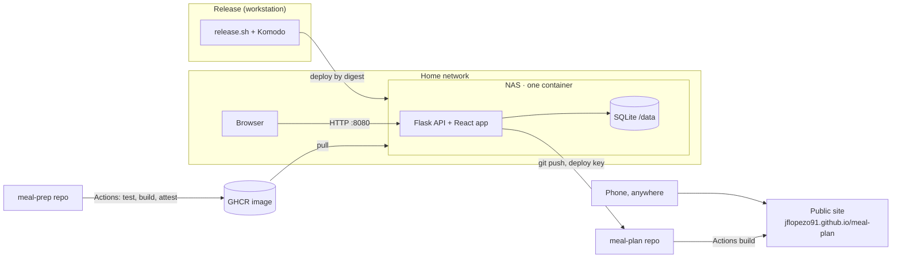

# Architecture

Meal Prep plans the household's week, says what to buy, and publishes a read-only copy for phones away from home.

## The system at a glance



- **Home app**: one container on the NAS. It plans, edits and publishes. Viewing is open on the home network; changes need a login.
- **Public site**: static files built from what the home app publishes. Read-only; nothing on GitHub can call the NAS.
- **Release**: GitHub builds and signs the image; a workstation decides when the NAS runs it (see phase 6d in the [plan](migration-to-cloud/README.md)).

## Core ideas

| Idea | In one sentence | Lives in |
|---|---|---|
| **Weekly plan** | A week's meals and groceries, saved as append-only revisions; generated by a solver, judged by rules. | `domain/weekly_plan.py`, `weekly_rules.py`, `snapshot.py` · `application/plan_workflows.py` |
| **Rules vs solver** | Rules are plain specifications in the domain; the OR-Tools solver only proposes plans and sits behind a port. A month is just several independent weeks. | `domain/weekly_rules.py` · `adapters/ortools/` |
| **Swap** | Replace one meal (or a linked pair) by hand; rules only warn. | `domain/swap.py` |
| **Shopping list** | A set of weeks; each week has a Long-lasting and a Fresh cell that is *To buy* or *Bought*. Bought cells freeze what was bought; the list is done when everything is bought. | `domain/shopping_trip.py` · `application/shopping_trips.py` |
| **Shelf life** | Each ingredient is long-lasting or fresh; read live from the inputs, never stored in plans. | `domain/catalog.py` |
| **Publish** | Copy chosen months and lists to the public repo as one commit, tagged with the code version that renders them. | `application/publication.py`, `publishing.py` |
| **Login** | Household users, server-side sessions; one guard checks every change. | `domain/auth.py` · `application/auth.py` · `entrypoints/http/auth_routes.py` |

## Backend layers

Ports and adapters, dependencies point inward (enforced by `planner/tests/test_architecture.py`):

```
entrypoints  →  application  →  domain
     ↘ wires        ↑ ports
       adapters ────┘   (SQLite, YAML, files, git, GitHub, OR-Tools)
```

| Layer | Holds | Rule |
|---|---|---|
| `domain/` | Business model and rules | Pure: no I/O, no frameworks |
| `application/` | Use cases and ports (interfaces) | Uses the domain; never an adapter |
| `adapters/` | Storage, files, git, solver | Implements ports |
| `entrypoints/` | HTTP routes, CLIs, wiring | Parses, delegates, serializes |

## Frontend

React + Vite in `site/`, one codebase, two modes:

- **API mode** (home app): reads and writes through `/api/v1`; editing code (`site/src/editing/`) loads only for logged-in users.
- **Static mode** (public site): reads a published bundle; no editing.

Readers (`site/src/readers/`) give both modes the same data shapes, so views do not care where data came from. Pure logic sits in `*Model.js` files and is unit-tested; components stay thin.

## Trust in five lines

1. **One secret:** the publish deploy key, a file on the NAS with write access to `meal-plan` only.
2. **Images by digest:** the NAS runs exactly the image GitHub built and attested for a release.
3. **Server decides:** the session check on the server is the boundary, not hidden buttons.
4. **Outbound only:** the NAS pushes to GitHub; nothing calls in. No port forwarding.
5. **State outside the image:** SQLite in `/data`, backed up before every release.

## Where do I put new code?

| New code | Goes in |
|---|---|
| A weekly plan rule | `domain/weekly_rules.py` + its solver encoding in `adapters/ortools/` (tests keep them in sync) |
| A shopping-list rule | `domain/shopping_trip.py` |
| An input validation rule | `domain/policies.py` |
| A use case | `application/` |
| Storage, file or network access | port in `application/ports.py`, implementation in `adapters/` |
| An HTTP route or CLI command | `entrypoints/` (delegate to a service) |
| Frontend logic | a `*Model.js` file (pure, tested); UI in `components/` or `editing/` |

Names: the UI says "shopping list", the code says `ShoppingTrip` (the weekly grocery DTO is `ShoppingList`).
