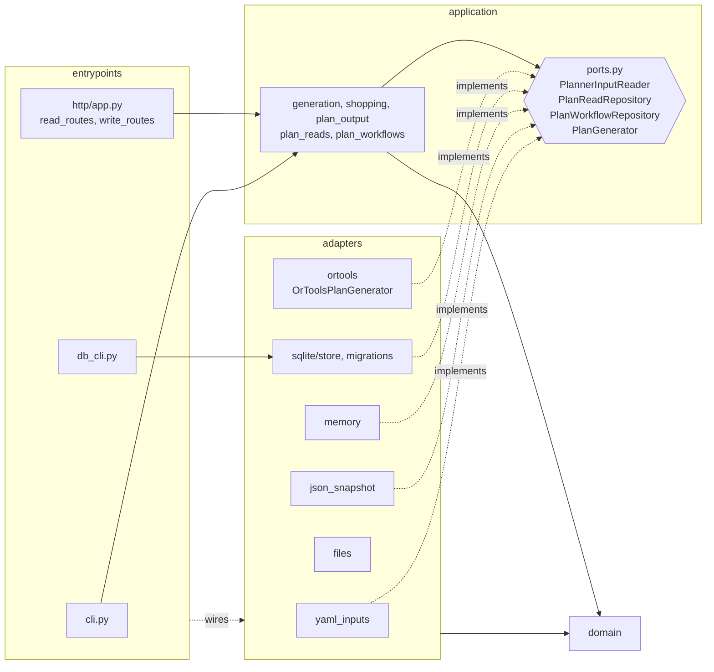

# Architecture

The planner (`planner/mealplanner/`) is a layered, ports-and-adapters design. Dependencies point inward; the rule is enforced by `planner/tests/test_architecture.py`.

## Layers and dependency rule

| Layer | Purpose | May import |
|---|---|---|
| `domain/` | Pure business model: catalog, variants, input policies, weekly plan rules (`weekly_rules.py`), plan snapshot, WeeklyPlan records. stdlib + pydantic only; no I/O, Flask, sqlite3, yaml, ortools, file paths. | `domain` |
| `application/` | Use cases and ports (incl. `PlanGenerator`): generation, shopping list, plan output DTOs, read service, WeeklyPlan workflows. Never imports ortools or adapters. | `domain` |
| `adapters/` | Implementations of the ports: YAML inputs, JSON snapshot, in-memory, SQLite, output files, and the OR-Tools generator (`adapters/ortools/`, the only place that imports ortools). | `domain`, `application` (ports, errors, DTOs) |
| `entrypoints/` | CLIs and the Flask app; compose adapters into services. | anything |

## Where key concepts live

- **WeeklyPlan lifecycle**: records, errors, diff and linked-pair helpers in `domain/weekly_plan.py`; create / propose / accept / discard / undo / `fill_month` in `application/plan_workflows.py` (month helpers and the deterministic `week_seed` in `domain/month.py`; a month fill is a batch of independent weekly plans); persistence port `PlanWorkflowRepository`, implemented by `adapters/sqlite/store.py` and `adapters/memory.py`.
- **PlanSnapshot**: `domain/snapshot.py` holds the immutable plan + shopping payload, `canonical_snapshot_id`, `validate_snapshot`, and `normalize_snapshot` (legacy weekday JSON to dated snapshot).
- **Weekly plan rules**: one specification per rule in `domain/weekly_rules.py` (`check_weekly_rules(plan, inputs)` on the dated snapshot; the module docstring maps each rule to its CP-SAT constraint). `PlanWorkflowService` runs them on every candidate before it can become a revision (create, proposal, accept, undo) and `db_cli` on fixture import; failures raise `RuleViolationError` (HTTP 422 `rule_violation`). Input validation stays in `domain/policies.py`.
- **Plan generation**: the `PlanGenerator` port in `application/ports.py`; the OR-Tools encoding of the rules (`model.py`, `solve.py`) and `OrToolsPlanGenerator` live in `adapters/ortools/`. Entrypoints inject the generator (`create_app(generator=...)`, CLI); the engine only proposes, the domain rules decide.
- **Planner inputs**: `domain/planner_inputs.py` (value object); read through the `PlannerInputReader` port by `adapters/yaml_inputs.py` or `adapters/sqlite/store.py`.
- **Read / write HTTP**: `entrypoints/http/read_routes.py` and `write_routes.py` only parse, map errors and serialize; rules live in `application/plan_reads.py` and `plan_workflows.py`. `app.py` is the factory (`create_app`) and dev server (`python -m mealplanner.entrypoints.http.app`).
- **CLIs**: `python -m mealplanner.entrypoints.cli` (also the `mealplanner` script) and `python -m mealplanner.entrypoints.db_cli` (import, backup, restore).

## Where do I put new code?

| New code | Goes in |
|---|---|
| A weekly plan business rule | `domain/weekly_rules.py` (one specification); its CP-SAT encoding in `adapters/ortools/` (keep them in sync; `test_weekly_rules.py` checks the generator against the specs) |
| A validation rule on recipes, ingredients or inputs | `domain/policies.py` |
| A new plan record, value object or domain error | `domain/` |
| A new use case or orchestration step | `application/` |
| A new storage or input boundary | Protocol in `application/ports.py`, implementation in `adapters/` |
| SQL, YAML, file or network access | `adapters/` |
| A new HTTP route or CLI command | `entrypoints/` (delegate to an application service) |
| Wiring adapters to services | `entrypoints/` |
