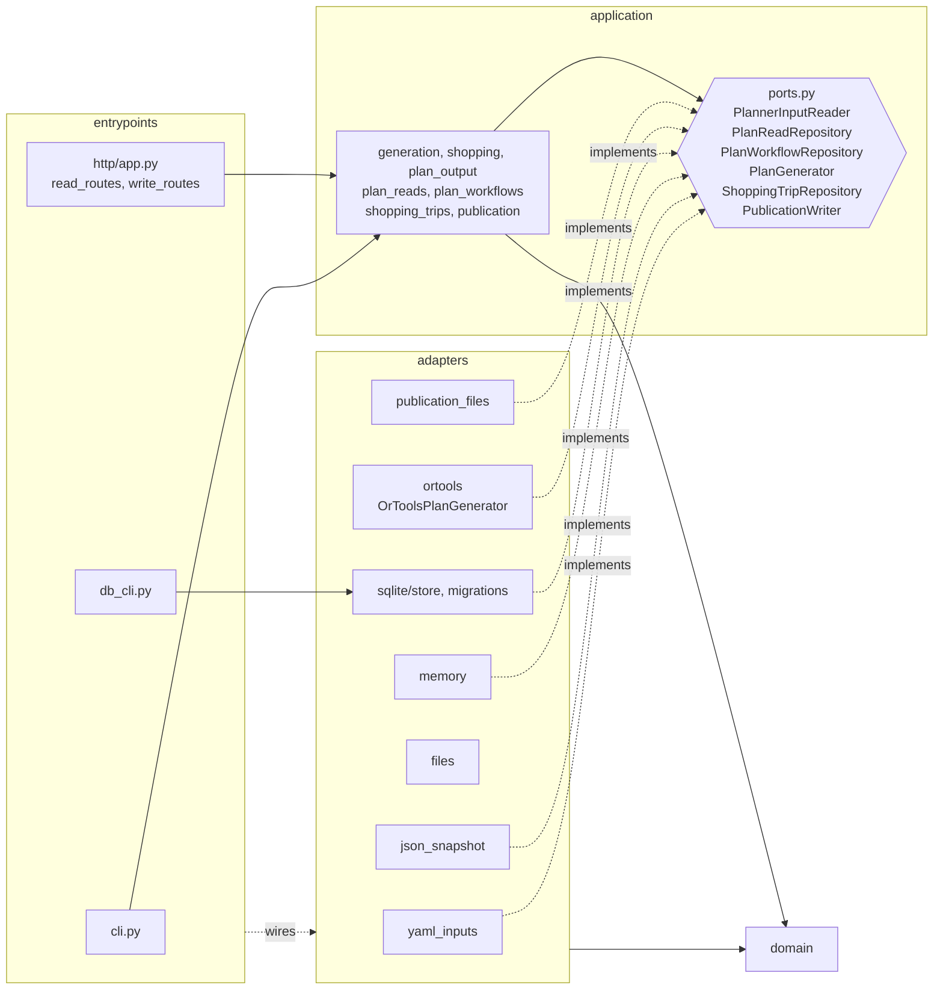

# Architecture

The planner (`planner/mealplanner/`) is a layered, ports-and-adapters design. Dependencies point inward; the rule is enforced by `planner/tests/test_architecture.py`.

## Layers and dependency rule

| Layer | Purpose | May import |
|---|---|---|
| `domain/` | Pure business model: catalog, variants, input policies, weekly plan rules (`weekly_rules.py`), plan snapshot, WeeklyPlan records. stdlib + pydantic only; no I/O, Flask, sqlite3, yaml, ortools, file paths. | `domain` |
| `application/` | Use cases and ports (incl. `PlanGenerator`): generation, shopping list, plan output DTOs, read service, WeeklyPlan workflows. Never imports ortools or adapters. | `domain` |
| `adapters/` | Implementations of the ports: YAML inputs, JSON snapshot, in-memory, SQLite, output files, and the OR-Tools generator (`adapters/ortools/`, the only place that imports ortools). | `domain`, `application` (ports, errors, DTOs) |
| `entrypoints/` | CLIs and the Flask app; compose adapters into services. | anything |

## Where key concepts live

- **WeeklyPlan lifecycle**: records, errors, diff and linked-pair helpers in `domain/weekly_plan.py`; create / propose / accept / discard / undo / `fill_month` in `application/plan_workflows.py` (month helpers and the deterministic `week_seed` in `domain/month.py`; a month fill is a batch of independent weekly plans); persistence port `PlanWorkflowRepository`, implemented by `adapters/sqlite/store.py` and `adapters/memory.py`.
- **Meal swaps** (phase 5): pure logic in `domain/swap.py` (`apply_swap` replaces a slot, and its linked partner for scope `pair`, using the shared `materialize_variant` in `domain/variants.py` that generation output also uses; it recomputes derived counts and groceries from the base revision's captured pantry; also `grocery_delta`, `extra_needed`, and swap provenance via `generation_baseline`/`swapped_assignment_ids`). Use cases `list_swap_variants`, `preview_swap` (stateless), `swap` (idempotent, appends one revision with source `swap`) live on `PlanWorkflowService`, which reads the `ShoppingTripRepository` port only to report trip impact. Weekly rules are advisory there: `check_weekly_rules` violations come back as warnings, and undo no longer refuses a rule-breaking restore. `Proposal.replaced_swaps` counts swapped slots a regeneration would replace. Routes: `write_routes.py` (`/plans/{id}/swaps[/preview]`) and `read_routes.py` (`/catalog/variants`).
- **ShoppingTrip** (phase 4; “shopping list” in the UI): aggregate in `domain/shopping_trip.py` (open/done status, `version`, covered weeks and their revisions on done, one-trip-per-week invariant, item summation and week coverage as pure functions); use cases in `application/shopping_trips.py`; persistence port `ShoppingTripRepository`, implemented by `adapters/sqlite/store.py` and `adapters/memory.py`. It reads plans through the existing plan ports and never writes them. Named `ShoppingTrip` in code to avoid clashing with the weekly `ShoppingList` DTO.
- **Publication export** (phase 4 minimal, hardened in phase 6): `application/publication.py` selects months, reads current plans, groceries and trips, builds and validates the bundle model; the `PublicationWriter` port writes it, implemented by `adapters/publication_files.py` (new immutable `publications/<id>/` directory, then `index.json` replaced last). Entry point: `db_cli export`.
- **PlanSnapshot**: `domain/snapshot.py` holds the immutable plan + shopping payload, `canonical_snapshot_id`, `validate_snapshot`, and `normalize_snapshot` (legacy weekday JSON to dated snapshot).
- **Weekly plan rules**: one specification per rule in `domain/weekly_rules.py` (`check_weekly_rules(plan, inputs)` on the dated snapshot; the module docstring maps each rule to its CP-SAT constraint). `PlanWorkflowService` enforces them on every generated candidate (create, month fill, proposal, accept) and `db_cli` on fixture import; failures raise `RuleViolationError` (HTTP 422 `rule_violation`). Manual swaps and undo only report violations as warnings (phase 5: the household decides). Input validation stays in `domain/policies.py`.
- **Plan generation**: the `PlanGenerator` port in `application/ports.py`; the OR-Tools encoding of the rules (`model.py`, `solve.py`) and `OrToolsPlanGenerator` live in `adapters/ortools/`. Entrypoints inject the generator (`create_app(generator=...)`, CLI); the engine only proposes, the domain rules decide.
- **Planner inputs**: `domain/planner_inputs.py` (value object); read through the `PlannerInputReader` port by `adapters/yaml_inputs.py` or `adapters/sqlite/store.py`.
- **Read / write HTTP**: `entrypoints/http/read_routes.py` and `write_routes.py` only parse, map errors and serialize; rules live in `application/plan_reads.py` and `plan_workflows.py`. `app.py` is the factory (`create_app`) and dev server (`python -m mealplanner.entrypoints.http.app`).
- **Container wiring** (phase 6a): `entrypoints/http/ops_routes.py` (`/healthz`, and same-origin serving of the built frontend when `MEALPLANNER_STATIC_DIR` is set); `create_app(trust_network_peers=...)` / `MEALPLANNER_TRUST_NETWORK_PEERS` for the container's port-mapping-only access control (temporary until login); `Dockerfile`, `deploy/entrypoint.sh` (create-or-migrate, then gunicorn) and `deploy/docker-compose*.yml` at the repository level.
- **Publishing** (phase 6b): `application/publishing.py` (`PublishingService`: validate months, sync, build via `PublicationService`, skip when the content hash matches the published one, write, commit and push, record a job; refreshes a `pushed` job from the deployment status). Ports in `application/ports.py`: `PublicationRepository` (git working copy of the public repo, `adapters/git_publication.py`, subprocess git over SSH, remote authoritative, never force-pushed), `DeploymentStatusReader` (`adapters/github_deployments.py`, unauthenticated GitHub REST), `PublishJobRepository` (`adapters/sqlite/publication_jobs.py`, table `publication_jobs`). Routes: `entrypoints/http/publish_routes.py`; wiring and `MEALPLANNER_PUBLISH_*` settings in `entrypoints/http/app.py`.
- **CLIs**: `python -m mealplanner.entrypoints.cli` (also the `mealplanner` script) and `python -m mealplanner.entrypoints.db_cli` (import, backup, restore, export).

## Where do I put new code?

| New code | Goes in |
|---|---|
| A weekly plan business rule | `domain/weekly_rules.py` (one specification); its CP-SAT encoding in `adapters/ortools/` (keep them in sync; `test_weekly_rules.py` checks the generator against the specs) |
| A shopping-trip rule (coverage, membership, status) | `domain/shopping_trip.py` |
| A validation rule on recipes, ingredients or inputs | `domain/policies.py` |
| A new plan record, value object or domain error | `domain/` |
| A new use case or orchestration step | `application/` |
| A new storage or input boundary | Protocol in `application/ports.py`, implementation in `adapters/` |
| SQL, YAML, file or network access | `adapters/` |
| A new HTTP route or CLI command | `entrypoints/` (delegate to an application service) |
| Wiring adapters to services | `entrypoints/` |

## Deployment and trust boundaries (phase 6)

- **One image, state outside it.** The container holds code and the API-mode frontend; SQLite lives in the `/data` volume. Entry points (gunicorn, `db_cli`) wire adapters exactly as in development.
- **Images are trusted by digest and provenance.** GitHub Actions builds and attests the image; the NAS runs `image@sha256:…` and an update starts with `gh attestation verify`. A moved tag cannot change what runs.
- **The only secret is the publish deploy key.** Write access to `jflopezo91/meal-plan` only, read from `/run/secrets/deploy_key` by the publication push adapter; it never reaches the browser, an image, a repository or an environment variable. Worst case if leaked: wrong public meal data, never code changes.
- **A publish is one commit.** The app writes `publication/` and `app-ref` (the meal-prep commit that renders the data, from `MEALPLANNER_APP_REVISION`) into a working copy of `meal-plan`, commits as `meal-prep publisher` and pushes `main` without force; ssh uses the mounted key with `IdentitiesOnly`, `BatchMode` and pinned host keys, and error messages shown to the API never contain key or working copy paths. A publish is `live` only after GitHub reports the run for that commit successful.
- **Publishing is outbound only.** The app pushes a validated bundle; the `meal-plan` workflow builds the static site from public `meal-prep` code at a pinned commit. Nothing on GitHub can call the NAS.
